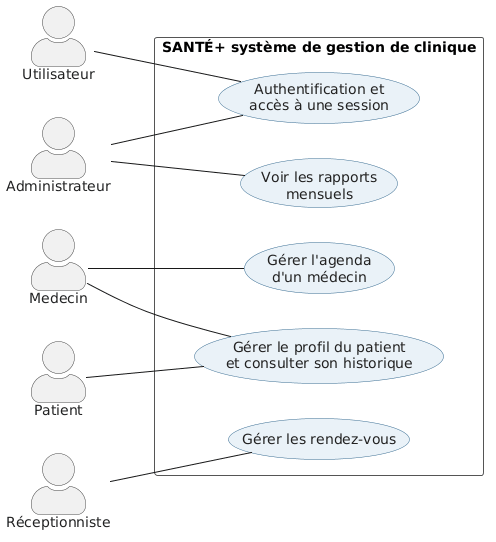
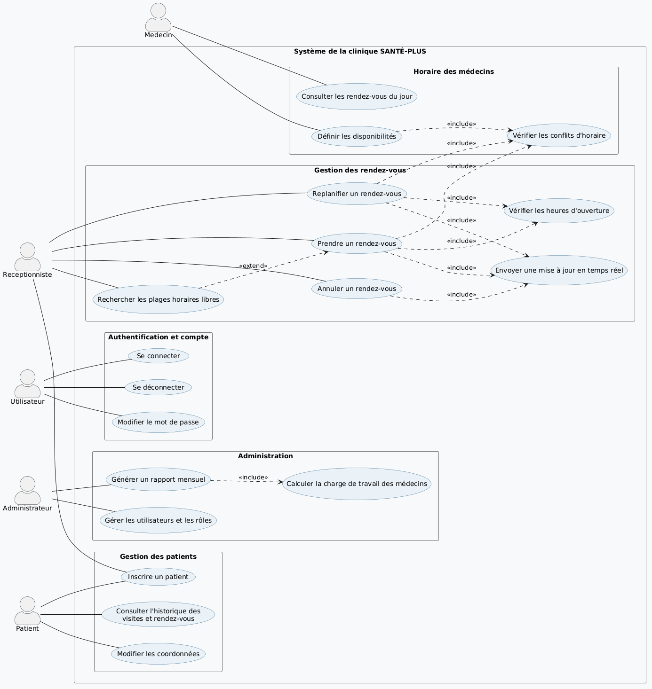
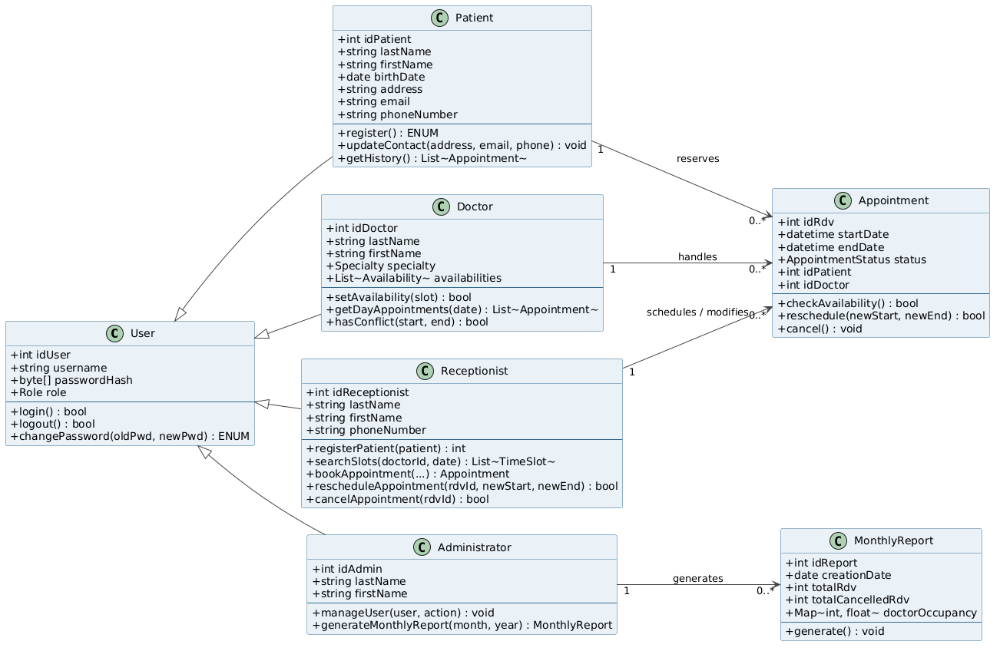
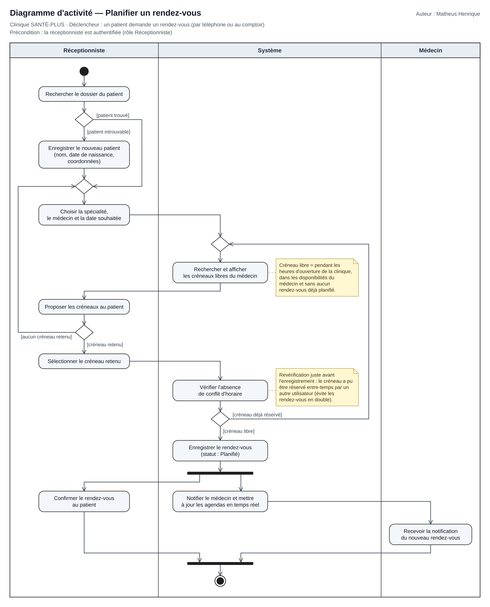
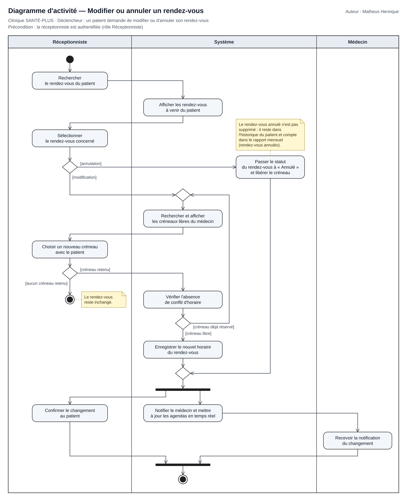

# Étude de cas - Système de Gestion de la Clinique Médicale
## 1.1 Objet du system a automatiser
les objets pouvant etre automatiser sont:
- **Utilisateur**
- **Administrateur**
- **Medecin**
- **Receptionniste**
- **Patient**
- **Rendez-vous**
- **Les rapport mensuel**

## 1.2 Caractéristiques et fonctionnalités de chaque objet
|Objet|Caractéristiques planifié |Fonctionnalités|
|-|-|-|
| Utilisateur | `ID_User: int`, `Username: String`, `PasswordHash: byte[]`, `Role: enum` | Peut s'authentifier, Modifier son mot de passe et se deconnecter
| Patient | `ID_Patient: int`, `LastName: String`, `FirstName: String`, `BirthDate: Date`, `Adresse: String`, `Email: String`, `PhoneNumber: String` | S'enregistrer dans le système, Mettre à jour ses coordonnées, Consulter son historique de visites et de rendez-vous
| Médecin | `ID_Doctor: int`, `LastName: String`, `FirstName: String`, `Specialty: enum`, `Disponibilités: Class` | Définir et gérer ses horaires, Consulter ses rendez-vous du jour, Éviter les conflits d'horaires
| Réceptionniste| `ID_Receptionist: int`,  `LastName: String`, `FirstName: String`, `PhoneNumber: String` | Enregistrer un patient, Planifier/modifier/annuler un rendez-vous, Rechercher un créneau disponible
| Administrateur | `ID_Admin: int`,  `LastName: String`, `FirstName: String` | Administrer les utilisateurs, Extraire les rapports mensuels et statistiques d'activité
| Rendez-vous | `ID_rdv: int`, `StartDate: Date`, `EndDate: Date`, `ID_Patient: int`, `ID_Doctor: int` | Créer un rendez-vous, Vérifier la disponibilité, Modifier un horaire, Annuler un rendez-vous
| Rapport | `ID_Report: int`, `CreationDate: Date`, `total_rdv: int`, `total_cancelled_rdv: int`, `MedicalOccuptions: Class` | Générer et afficher les statistiques mensuelles pour l'administration

## 2.1 Diagramme de cas d’utilisation
### 2.1.1 Version generale

### 2.1.2 Version detaillé

## 2.2 Diagramme de classes

## 2.3 Diagramme d'activité

